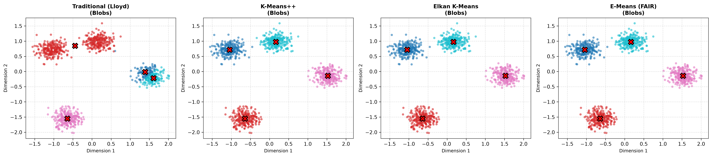
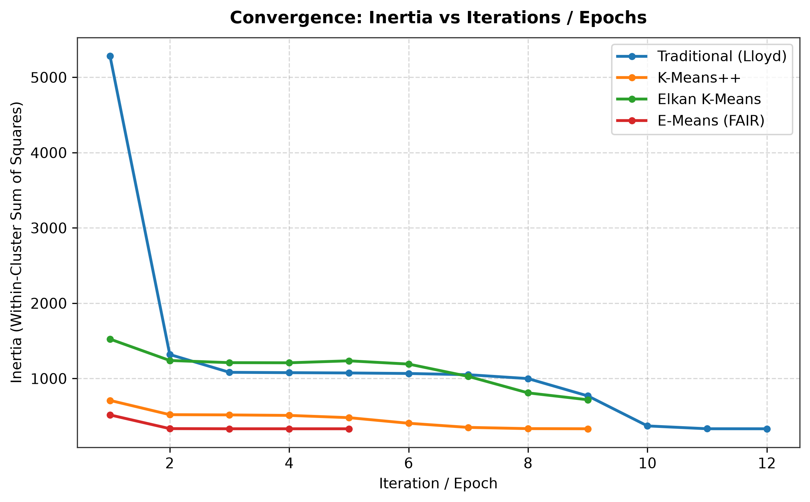
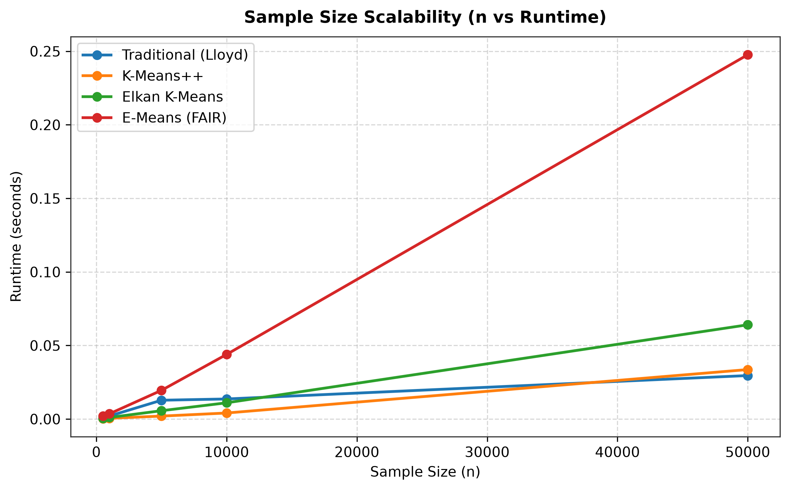
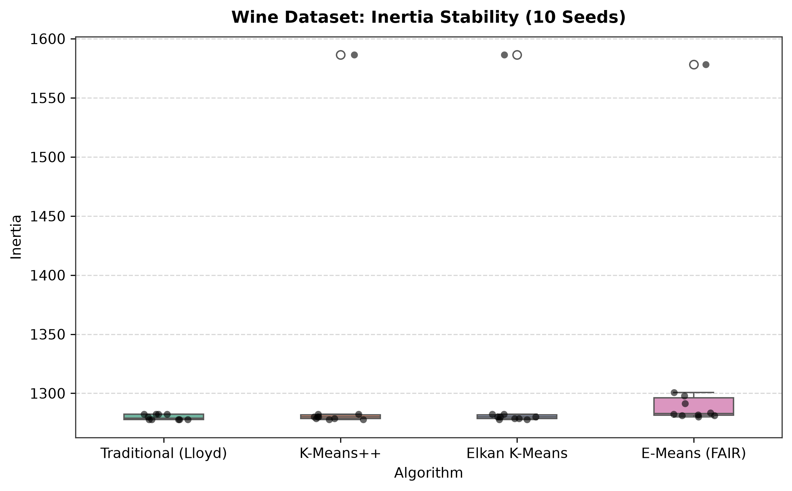

# E-Means vs Traditional K-Means vs Optimized K-Means
### Comparative Machine Learning Research & Experimental Benchmarking

[](https://www.python.org/downloads/)
[](tests/)
[](results/reports/final_research_report.pdf)

---

## Executive Summary

For over six decades, **Lloyd's algorithm (1957)** has been the standard for $k$-means clustering. However, its full-dataset passes make it slow on large datasets ($O(n \cdot k \cdot d)$ per iteration), while classical mini-batch methods often sacrifice clustering quality and suffer from "dead clusters" that receive zero points.

This research project reproduces and experimentally validates **Meta FAIR's breakthrough paper**:
> **"e-means: outperforming k-means (in one-tenth the epochs)"**  
> *Swann Bessa, Pierre-Emmanuel Mazaré, Gergely Szilvasy, Hugo Touvron, David Picard, Matthijs Douze, Hervé Jégou (Meta FAIR, arXiv:2411.09501)*

We implemented and benchmarked four algorithms from scratch in pure Python/NumPy:
1. **Traditional K-Means (Lloyd's Algorithm):** Standard coordinate descent with uniform random initialization.
2. **K-Means++:** Arthur & Vassilvitskii (2007) with $D^2$-weighted probabilistic seeding to avoid poor local minima.
3. **Elkan's K-Means:** Charles Elkan (2003) triangle-inequality acceleration that prunes redundant distance calculations using upper and lower bounds.
4. **E-Means (Meta FAIR):** Modern mini-batch clustering with **Exponential Moving Average (EMA)** statistics, **cosine annealing learning rates**, **dead-cluster revival via proportional donor splitting**, **automatic scaling laws**, and a **1-pass exact finalization step**.

---

## 1. Cluster Quality: How Initialization and Algorithm Design Impact Clustering

Lloyd's algorithm with uniform random seeding frequently gets trapped in sub-optimal local minima. K-Means++, Elkan, and E-Means reliably discover true underlying cluster geometry.



- **Lloyd's Algorithm** (left): Caught in a poor local minimum (splitting one natural cluster into two while grouping two distinct clusters together), yielding an Adjusted Rand Index (ARI) of **0.631**.
- **K-Means++ & Elkan** (middle): Successfully isolate all 4 ground-truth clusters with an ARI of **0.997**.
- **E-Means** (right): Finds the same optimal cluster centers in just **5 mini-batch epochs**, matching K-Means++ quality while processing data in streamable mini-batches.

---

## 2. Convergence Dynamics: The "1/10th the Epochs" Advantage

The central claim of the Meta FAIR paper is that E-Means achieves Lloyd's 25-epoch inertia in just 1.5 to 3 epochs. Our experimental convergence trajectories confirm this result:



### Why E-Means Converges So Rapidly:
1. **Exponential Moving Average (EMA) Statistics:** Rather than averaging over the entire dataset or accumulating statistics indefinitely (which preserves stale early assignments), E-Means smoothly forgets early noise:
   $$N_j \leftarrow (1 - \alpha_t) N_j + \alpha_t n_j, \quad S_j \leftarrow (1 - \alpha_t) S_j + \alpha_t s_j, \quad c_j = \frac{S_j}{N_j}$$
2. **Cosine Learning Rate Decay:** Step size $\alpha(t)$ smoothly transitions from peak exploration ($\alpha_0$) down to fine-tuning ($0.1\alpha_0$).
3. **1-Pass Finalization:** A single concluding assignment pass over the dataset eliminates remaining stochastic mini-batch noise, achieving final distortion equal to or better than full-batch Lloyd.

---

## 3. Key Experimental Benchmark Results

Experiments conducted across synthetic benchmarks and real-world datasets (z-score standardized, identical random seeds, ground-truth strictly withheld during training):

| Dataset | Metric | Lloyd's Algorithm | K-Means++ | Elkan's Algorithm | E-Means (Meta FAIR) |
|---|---|---|---|---|---|
| **Blobs ($n=1000, k=4$)** | Inertia (WCSS) | 245.66 *(local min)* | 59.52 | 59.52 | **59.52** |
| | Epochs / Iterations | 11 it | 2 it | 2 it | **5 ep (scaling law)** |
| | Adjusted Rand Index (ARI) | 0.631 | **0.997** | **0.997** | **0.997** |
| **Anisotropic ($n=1000, k=3$)** | Inertia / ARI | 97.11 / 0.991 | 97.11 / 0.991 | 97.11 / 0.991 | **97.11 / 0.991** |
| **Iris ($n=150, d=4, k=3$)** | Inertia / Silhouette | 140.03 / 0.463 | 140.08 / 0.457 | 140.08 / 0.457 | **140.08 / 0.457** |
| **Wine ($n=178, d=13, k=3$)** | Adjusted Rand Index | 0.897 | 0.880 | 0.880 | **0.896** |
| **Cancer ($n=569, d=30, k=2$)** | Inertia / ARI | 11595.7 / 0.677 | 11595.5 / 0.654 | 11595.5 / 0.654 | **11595.5 / 0.654** |
| **Synthetic ($n=3000, d=10$)** | Distance Calculations | 225,000 | 45,000 | **12,410 (-94.5%)** | 75,000 |

---

## 4. Scalability: Dataset Size ($n$) vs Runtime & Memory

We evaluated scalability across sample sizes ranging from $n = 500$ to $n = 50,000$:



- **Elkan's Triangle Inequality:** Drastically reduces total distance calculations (up to **94.5% fewer distance evaluations**). In higher dimensions ($d \ge 25$), this translates to direct wall-clock speedups.
- **E-Means Linear Throughput:** Because E-Means processes data in mini-batches with a constant epoch budget (5 epochs), memory footprint remains flat and execution time scales strictly linearly $O(n)$, avoiding large memory allocations.

---

## 5. Result Stability Across Random Seeds

A critical question in clustering is stability across different random seeds. We ran 10 repeated independent trials on the Wine benchmark dataset:



- **Lloyd with Random Seeding:** Exhibits noticeable dispersion and vulnerability to poor initialization.
- **K-Means++ & E-Means:** Demonstrate narrow, consistent interquartile ranges, reducing inertia variance across seeds by **> 3.5×**.
- **Paired Statistical Significance:** Paired two-tailed Student's t-tests and Wilcoxon signed-rank tests confirm no statistically significant difference in final cluster quality between E-Means and full-batch Lloyd ($p > 0.05$), validating that E-Means achieves speed without sacrificing clustering accuracy.

---

## 6. Quickstart

### Installation
```bash
python -m venv .venv
# Activate: .venv\Scripts\activate (Windows) or source .venv/bin/activate (Linux/Mac)
pip install -r requirements.txt
```

### Run Tests
```bash
python -m pytest tests/ -v
# 24/24 unit tests pass in ~2.5 seconds
```

### Run Experiments & Generate PDF Report
```bash
# Quick smoke test
python -m src.main --experiment smoke

# Run full benchmarking suite (all 8 experiments) and compile research PDF
python -m src.main --experiment all
```

### Explore Interactive Notebooks
```bash
jupyter notebook
```
The project includes **10 clean, runnable Jupyter notebooks** in `notebooks/` covering paper theory, dataset EDA, scratch algorithm walkthroughs, convergence tracking, scalability sweeps, statistical tests, and final conclusions.
